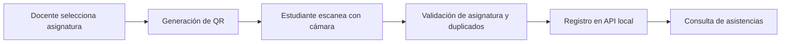

# qrScannerApp
### Registro académico de asistencia mediante códigos QR

Prototipo académico de aplicación móvil desarrollado con Ionic y Angular. Conecta la generación de un QR por asignatura con su lectura desde el teléfono y el registro de asistencia mediante una API local de desarrollo.

El proyecto muestra integración de cámara con Capacitor, consumo HTTP, formularios y validaciones en TypeScript.

## Funcionalidades

- Inicio de sesión de demostración para estudiantes y docentes.
- Consulta de asignaturas.
- Generación de códigos QR con el formato `asignatura:<id>`.
- Lectura del QR mediante la cámara y solicitud de permisos.
- Validación de la asignatura asociada al estudiante.
- Comprobación de asistencia ya registrada para la misma asignatura y fecha.
- Registro y consulta de asistencias mediante HTTP.

## Tecnologías

| Área | Herramientas |
| --- | --- |
| Interfaz | Ionic 8, Angular 18, HTML y SCSS |
| Lógica | TypeScript y RxJS |
| Capacidades móviles | Capacitor 6 y Barcode Scanner |
| Generación QR | ng-qrcode |
| API de demostración | JSON Server |

Las versiones corresponden a las dependencias declaradas en [package.json](package.json).

## Flujo principal



## Preparar el entorno

Necesitas Git, Node.js y npm compatibles con Angular 18. Para probar la cámara necesitas un dispositivo Android, Android Studio y el entorno Android de Capacitor.

```bash
git clone https://github.com/FRojasRiffo/qrScannerApp.git
cd qrScannerApp
npm install
```

### 1. Iniciar la API de demostración

Desde la raíz del repositorio, en una terminal:

```bash
npx --yes json-server@0.17.4 --watch jsonServer/db.json --routes jsonServer/routes.json --host 0.0.0.0 --port 3000
```

Se fija JSON Server 0.17.4 para usar la sintaxis `--watch` y `--routes` de esta guía. La API lee y modifica `jsonServer/db.json`; las acciones de demostración pueden cambiar ese archivo.

Recursos principales:

| Ruta | Uso |
| --- | --- |
| `GET /usuarios` | Usuarios de demostración |
| `GET /asignaturas` | Asignaturas |
| `GET /asistencias` | Asistencias |
| `POST /asistencias` | Nuevo registro |
| `PUT /usuarios/:id` | Actualización de usuario |

### 2. Configurar la dirección de la API

La dirección debe apuntar al equipo que ejecuta JSON Server:

- En un navegador del mismo equipo: `http://localhost:3000`.
- En un teléfono: `http://<IP-local-del-equipo>:3000`, con ambos equipos en la misma red.

Configura **ambos lugares**:

1. La URL usada en [login.page.ts](src/app/login/login.page.ts), que también puede guardarse desde la pantalla de inicio de sesión.
2. La propiedad `apiUrl` de [api.service.ts](src/app/services/api.service.ts).

Actualmente el servicio conserva su propia dirección fija: cambiar la URL del inicio de sesión no actualiza automáticamente las demás consultas.

### 3. Abrir la interfaz web

En otra terminal:

```bash
npm start
```

Abre **http://localhost:4200/**. Puedes revisar las pantallas y las consultas HTTP en el navegador; el flujo de cámara utiliza el complemento nativo y debe probarse en Android.

Usa las cuentas de demostración de `jsonServer/db.json`, cuyos campos son `correo`, `contraseña` y `tipo`. No introduzcas credenciales ni datos personales reales.

### 4. Preparar la aplicación Android

```bash
npm run build
npx cap sync android
npx cap open android
```

El proyecto Android ya se encuentra en `android/`. Desde Android Studio, selecciona un dispositivo, revisa la compatibilidad entre el complemento de escaneo y Capacitor, y ejecuta la aplicación. La lectura depende de los permisos de cámara y la API debe ser accesible desde el teléfono.

## Recorrido de demostración

1. Inicia JSON Server y configura la misma URL de API en el inicio de sesión y el servicio.
2. Ingresa como docente y genera el QR de una asignatura.
3. Ingresa como estudiante asociado a esa asignatura desde el dispositivo.
4. Escanea el QR y consulta la asistencia registrada.
5. Repite el escaneo para revisar la validación de duplicados.

## Estructura

```text
src/app/
├── login/                 # Acceso de demostración y URL de API
├── asignaturas/           # Vista del estudiante
├── asignaturas-docente/   # Vista del docente
├── crear-qr/              # QR por asignatura
├── leer-qr/               # Cámara y validaciones
├── asistencias/           # Consulta de registros
├── services/api.service.ts
└── models/models.ts
jsonServer/                # Datos y rutas de la API local
android/                   # Proyecto nativo
```

## Comandos disponibles

```bash
npm start        # Servidor de desarrollo
npm run build    # Compilación web en www/
npm run lint     # Análisis estático
npm test         # Pruebas configuradas con Karma y Jasmine
```

Estos comandos están declarados en el proyecto; su presencia no implica que la compilación o las pruebas se hayan validado en todos los entornos.

## Alcance del prototipo

El acceso compara datos de usuarios en el cliente y el restablecimiento de contraseña muestra un aviso simulado. No hay autenticación de producción ni envío real de recuperación de contraseña. Las validaciones de asistencia también se ejecutan en el cliente.

Los próximos pasos son unificar la configuración de API, incorporar autenticación y validaciones en el servidor, y ampliar las pruebas del flujo QR.

## Autor

[Felipe Antonio Rojas Riffo](https://github.com/FRojasRiffo) · Ingeniería en Informática, Duoc UC
